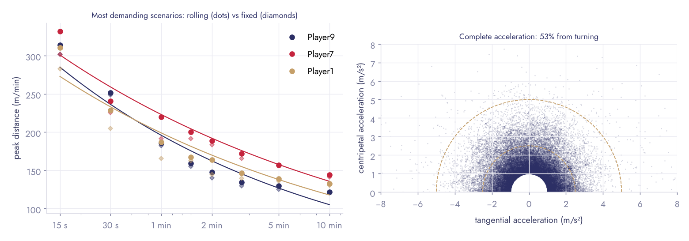

# peakdemands

Bursts, most demanding scenarios (MDS) and GPS 3.0 exposure metrics from
tracking data — GPS, LPS or optical — with a designed PDF report.

```python
import peakdemands as pk

kin = pk.from_positions(time, x, y)        # x, y in metres; or pk.from_speed(time, speed)
sprints = pk.sprints(kin, 7.0)             # efforts > 7 m/s held ≥ 1 s
curve = pk.peak_curve(kin, "distance")     # rolling peaks for 15 s … 10 min, fixed epochs, power law
from peakdemands.report import session_report
session_report(kin, "match.pdf", athlete="Player 9", mss=9.2, mas=17.0)
```

**[Example report (EN)](docs/example_match_en.pdf) · [Exemple de rapport (FR)](docs/example_match_fr.pdf)** —
a full professional match, from open optical tracking data.

## What it does, and where each definition comes from

| | Definition | Source |
|---|---|---|
| **Complete acceleration** | From x, y: tangential (speed change) and centripetal (turning) components, \|a\|² = a<sub>t</sub>² + a<sub>c</sub>². Savitzky-Golay smoothing, tracking jumps removed. | Buchheit & Simpson 2017; Buchheit et al. 2026 (GPS 3.0) |
| **Efforts (bursts)** | Runs above a threshold held ≥ 1 s (speed) or ≥ 0.5 s (acceleration); sprints, high-speed efforts, accelerations, decelerations, turns. | Harper et al. 2019 (> 2.5 m/s²) |
| **Near-to-MSS exposures** | Efforts above 85, 90, 95 % of maximal sprinting speed. | Buchheit et al. 2023 |
| **Repeated-sprint sequences** | ≥ 2 efforts no more than 60 s apart. | Buchheit et al. 2010 |
| **Repeated-sprint bouts** | ≥ 3 sprints, mean recovery < 21 s. | Spencer et al. 2004 |
| **Most demanding scenarios** | Peak of the rolling average per window length (15 s → 10 min), with the fixed-epoch value, the time of the peak, the next window and the number of separate passages ≥ 90 % of the peak. Distance, high-speed distance, acc + dec per minute. | Varley et al. 2012; Fereday et al. 2020; Whitehead et al. 2018; Novak et al. 2021 |
| **Intensity-duration law** | I = c·t<sup>n</sup>, least squares in log-log space. | Delaney et al. 2018 |
| **Capacity anchors** | Bundle speed-duration model; Estimated Maximal S1min = MAS + 0.695·(MSS − MAS) (Eq. 1); Estimated Maximal MP1min = 1.045·[MAS/3.6 + 0.695·(MSS − MAS)/3.6] (Eq. 2). | Bundle et al. 2003; Buchheit et al. 2026 |
| **IET / WIET** | Minutes with the 60-s rolling average above 60/70/80 % of a reference; summed over a week. | Buchheit et al. 2026 |

**What it does not do.** The mechanical work and power of the GPS 3.0 paper come from a
proprietary analyser (ADI, Hudl) whose algorithm is not published. `peakdemands` does not
pretend to reproduce it: `velocity_change_power` (speed × |complete acceleration|) and
`directional_share` are open, documented proxies that show how much of the effort comes
from turning, and their values must not be compared with ADI watts.

## Example: a real match

`load_metrica()` downloads the Metrica Sports sample data (an anonymised professional
match, optical tracking at 25 Hz) on first use; the files are not redistributed here.
For one midfielder: 9.7 km, 7 sprints above 7 m/s, peak 1-min distance 186 m/min (1.8 × the
match average), fixed epochs underestimating the peaks by 0.3–5 %, and **53 % of the complete
acceleration coming from direction changes** — the share classic GPS metrics leave out
(the GPS 3.0 paper reports 30–70 % in drills).



## Install

```bash
pip install "peakdemands[report] @ git+https://github.com/Clement0242/peakdemands"
```

PDF reports use WeasyPrint (Pango needed: `apt install libpango-1.0-0 libpangoft2-1.0-0`).
Typeface: Jost (SIL Open Font License, shipped).

## Tests

Ground truths on synthetic signals: a constant-speed circle (pure centripetal acceleration,
3 m/s² recovered within 2 %), a straight constant acceleration, a simulated session with
known sprints, a hard minute straddling two fixed epochs (the rolling peak finds it, fixed
epochs do not), Bundle's 0.695 constant, IET on a known profile, Spencer bouts. Run
`pytest`.

## En français

`peakdemands` détecte les efforts (sprints, accélérations, décélérations, changements de
direction, séquences répétées), calcule les scénarios les plus exigeants par fenêtres
glissantes et leur loi de puissance, décompose l'accélération en vitesse et en direction,
et calcule le temps d'exposition (IET) proposé par Buchheit et al. (2026, « GPS 3.0 »).
Un rapport PDF de séance, en français ou en anglais, sort en une ligne.

## References

Buchheit M., Lopez Sagarra A., Boskovic A., Komino P., Norman D., Hader K. (2026). GPS 3.0. *Sport Perf Sci Rep* 280 ·
Buchheit & Simpson (2017). *IJSPP* 12(S2):S235 · Bundle, Hoyt & Weyand (2003). *J Appl Physiol* 95:1955 ·
Buchheit et al. (2010). *Int J Sports Med* 31:709 · Buchheit et al. (2023). *Biol Sport* 40:1057 ·
Spencer et al. (2004). *J Sports Sci* 22:843 · Harper, Carling & Kiely (2019). *Sports Med* 49:1923 ·
Varley, Elias & Aughey (2012). *IJSPP* 7:183 · Fereday et al. (2020). *J Sci Med Sport* 23:764 ·
Delaney et al. (2018). *Sci Med Football* 2:86 · Novak et al. (2021). *J Sports Sci* 39:1850 ·
Whitehead et al. (2018). *Sports Med* 48:2549 · Rico-González et al. (2022). *Biol Sport* 39:695.

Data: Metrica Sports sample data (github.com/metrica-sports/sample-data).

## Licence

MIT. Clément Verdier.
